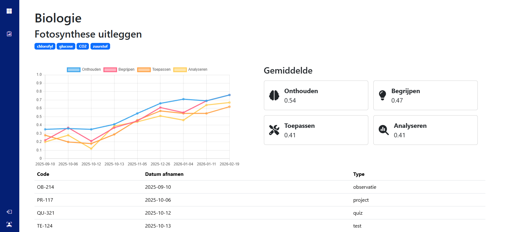
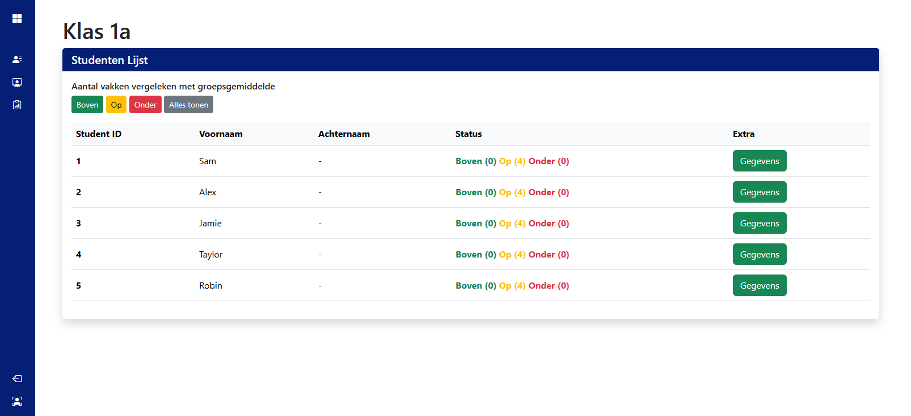
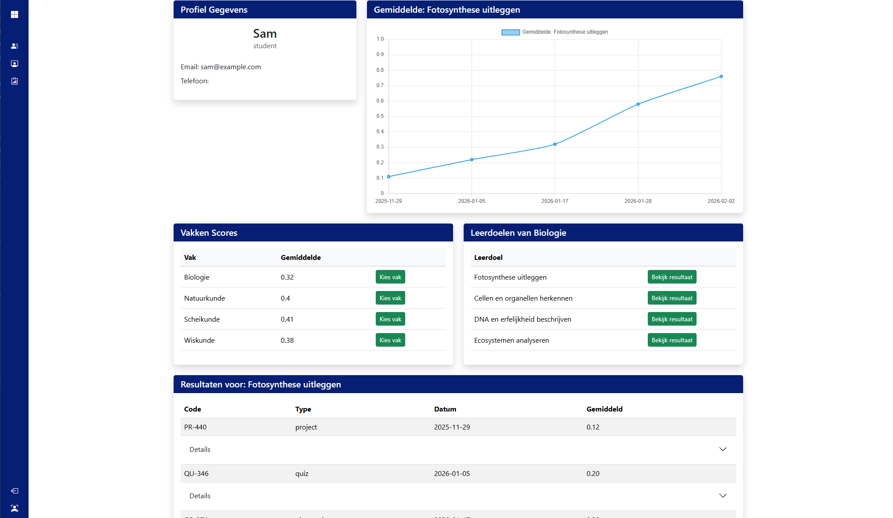

# Welkom bij het Test Correct Leerlingen Dashboard
Dit project is gemaakt door Team: **1C1 GOAT**  

De studenten die aan dit project hebben gewerkt zijn:  
* Mesut Özen (0838372)  
* Mohamed Outourght (1130352)  
* Lucas Vermeulen (1120319)  

---

## Beschrijving
Dit project is een proof-of-concept webapplicatie die leerlingresultaten uit Test Correct visualiseert.  
Leerlingen krijgen inzicht in hun voortgang per vak en leerdoel, terwijl docenten deze gegevens kunnen bekijken per student of in klasoverzichten.  

---


## Functies

**Leerling:**  
- Inzicht in hoe goed het gaat met je vakken vergeleken met je klasgenoten  
- Voortgang over tijd per leerdoel  
- Inzicht in je eigen toetsen, quizzes en observaties  

**Docent:**  
- Klasoverzicht  
- Inzicht in de voortgang per student en per leerdoel  

**Algemeen:**  
- Basis-authenticatie (leerling vs docent)  
- Eigen profiel  

---

## Technische informatie
- Backend: Python + SQLite  
- Frontend: HTML, CSS, JavaScript  
- Communicatie: AJAX/REST  
- Dependencies: zie `requirements.txt`  

---

## Installatie & Setup
```bash
# Clone de repository
git clone <repo-url>

# Ga naar de projectmap
cd <project-map>

# Installeer dependencies
pip install -r requirements.txt

# Genereer voorbeelddata
python generate_data_sample.py

# Voeg de data toe aan de database
python DataBaseSeeder.py

# Start de applicatie
python app.py

```
## Inlog gegevens
**Student**
* **Email Address:** jamie@example.com
* **Wachtwoord:** geheim

**Docent**
* **Email Address:** henk@mail.nl
* **Wachtwoord:** secret



